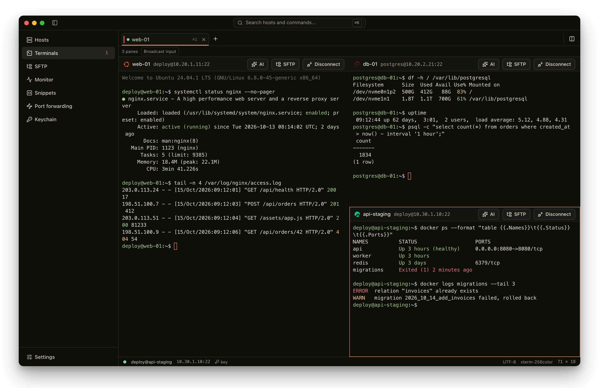
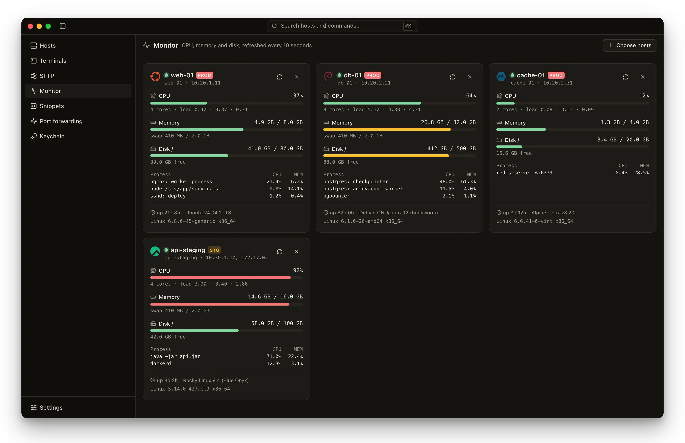
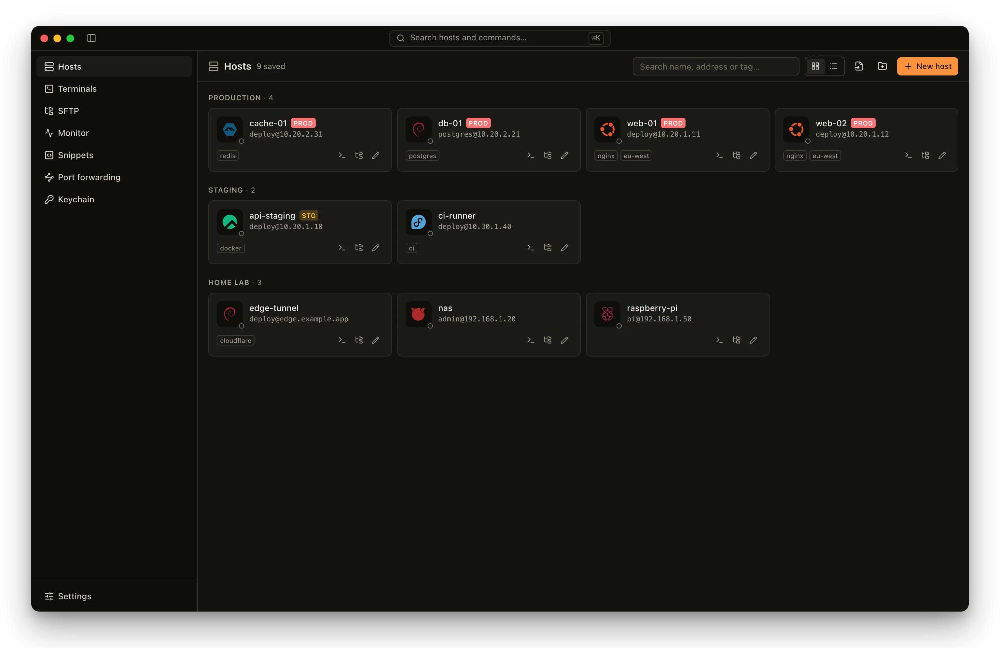
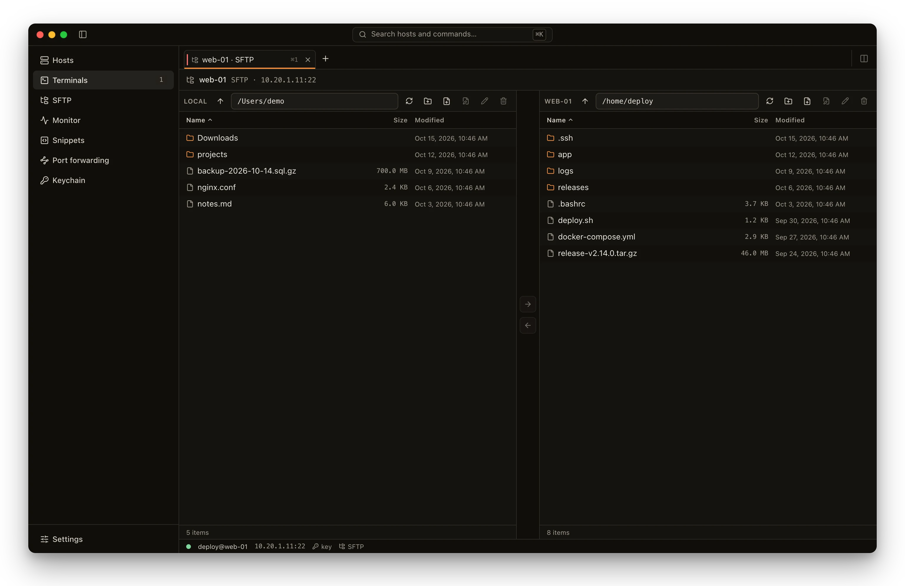
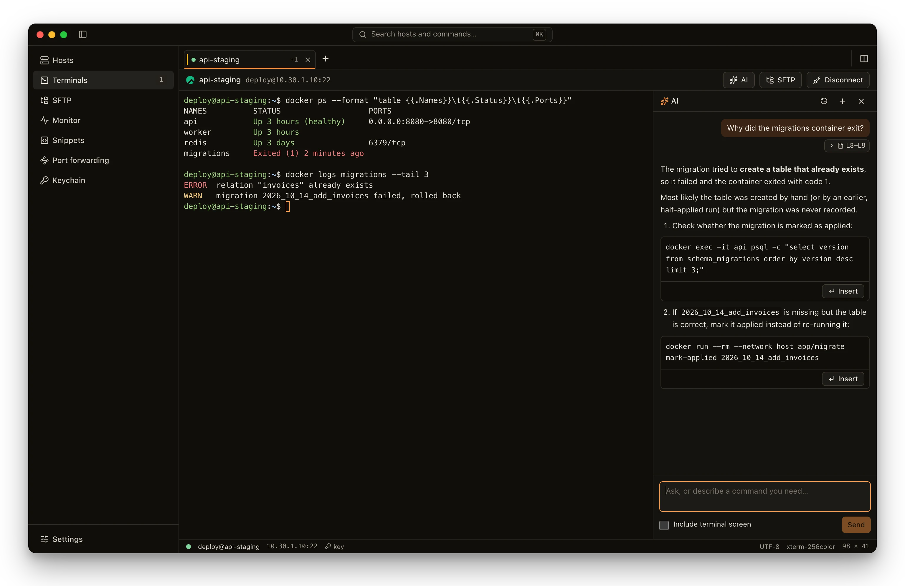
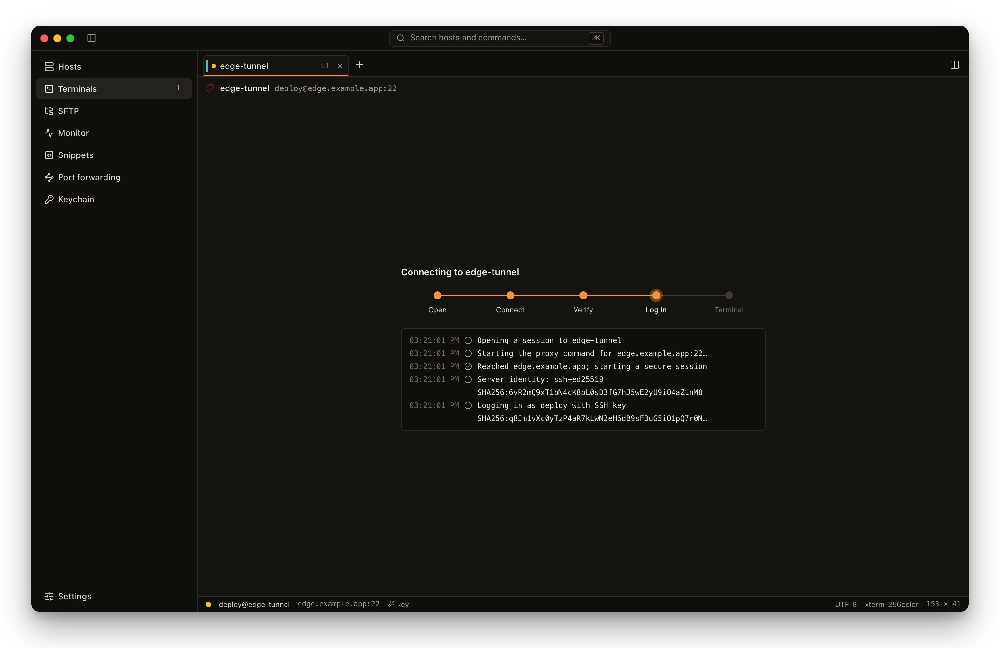
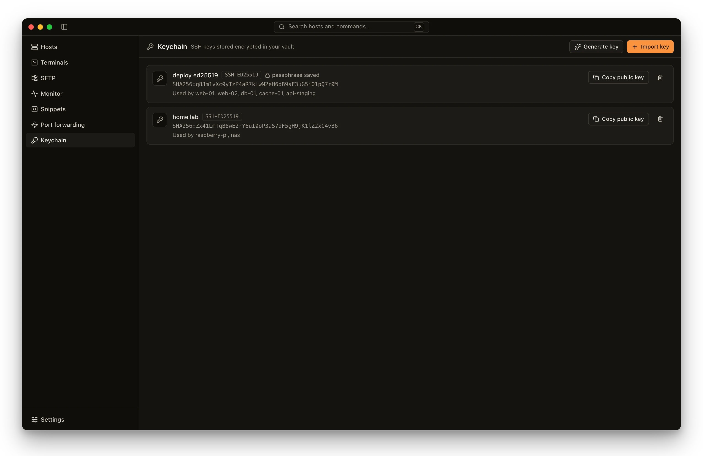
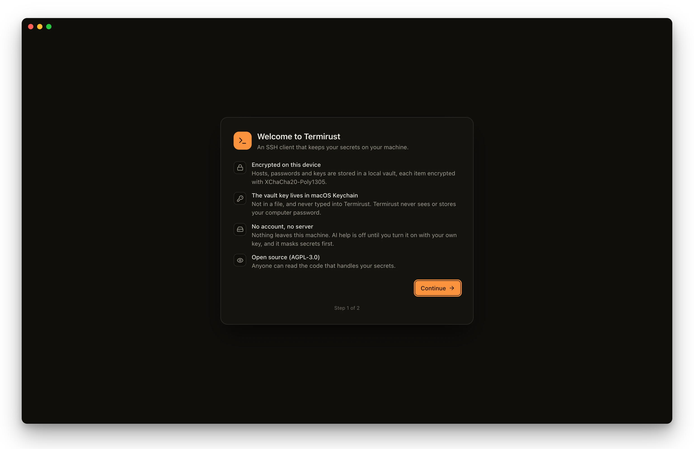

<p align="center">
  
</p>

<h1 align="center">Termirust</h1>

<p align="center">
  <b>The local-first SSH client, written in Rust.</b><br>
  Your hosts, keys and passwords stay encrypted on your machine — no account, no cloud, no telemetry.
</p>

<p align="center">
  <a href="https://github.com/TermiRust/termirust/releases/latest"></a>
  <a href="LICENSE"></a>
  <a href="https://github.com/TermiRust/termirust/actions/workflows/ci.yml"></a>
  
</p>

<p align="center">
  <a href="https://github.com/TermiRust/termirust/releases/latest">Download</a> ·
  <a href="#features">Features</a> ·
  <a href="#security">Security</a> ·
  <a href="#build-from-source">Build</a> ·
  <a href="CONTRIBUTING.md">Contributing</a>
</p>

<p align="center">
  
</p>

## About

Termirust is an open-source desktop SSH client for people who live in terminals: developers,
sysadmins and DevOps engineers. It brings the comfort of commercial SSH apps — a host library,
split panes, SFTP, port forwarding, a server monitor and an optional AI assistant — without asking
you to create an account or hand your credentials to anyone's cloud.

> **Status: pre-release (0.x).** Usable every day, but expect rough edges until 1.0.
> Found something? [Open an issue](https://github.com/TermiRust/termirust/issues/new/choose).

## Why Termirust

- 🔐 **Your secrets never leave your machine.** Every host, key and password is encrypted
  individually in a local vault (XChaCha20-Poly1305). The vault key lives in your operating
  system's keychain — never in a file, never on a server. There is no account to sign up for.
- 🙈 **No telemetry, ever.** Termirust only talks to the servers you connect to, GitHub when it
  checks for updates (you can turn that off), and — only if you enable it — the AI provider you chose.
- ⚡ **Fast and light.** A Rust core on Tauri and the system webview: a ~14 MB app (≈5 MB installer
  on Windows) that starts instantly and streams terminal output without stalling the UI.
- 🧰 **Built for real operations.** Compare servers side by side, watch CPU / memory / disk across
  your fleet, reach hosts through jump hosts or Cloudflare Tunnel, move files with SFTP.
- 📖 **Open source (AGPL-3.0).** Anyone can read and audit the code that handles your credentials.

## Features

### 📊 Monitor your servers at a glance

CPU, memory, swap, disk, uptime and top processes for several servers, refreshed every 10 seconds —
read over a separate channel, so nothing appears in your terminals.



### 🗂️ A host library that stays organised

Groups, tags, OS icons detected on first connect, PROD / STAGING markers with a terminal watermark,
and one-click import from `~/.ssh/config`.



### 📁 SFTP without leaving the app

Two-panel browser with drag and drop, a transfer queue, a right-click menu, in-place editing of text
files and “open with” any app.



### 🤖 An AI assistant that respects your secrets

Optional and bring-your-own-key (Anthropic, OpenAI, DeepSeek, Gemini, Ollama or any OpenAI-compatible
endpoint). Quote terminal lines, get commands you can insert; secrets are masked before anything is sent.



### 🔌 Connections that explain themselves

Step-by-step connection progress and a plain-language log: which route, which server identity, which
key — and what to fix when a login fails.



### 🔑 Keys in an encrypted keychain

Import or generate Ed25519 keys, keep passphrases encrypted, see which hosts use which key. Private
keys never reach the UI.



**Also inside:** split panes with broadcast input · tabs that shrink into a searchable switcher ·
jump hosts and OpenSSH `ProxyCommand` (Cloudflare Tunnel, AWS SSM, GCP IAP templates) · local,
remote and dynamic (SOCKS) port forwarding · snippets with variables, run on one or many hosts ·
auto-reconnect · ⌘K command palette · app-wide themes and iTerm2 / Windows Terminal scheme import ·
signed automatic updates.

## Security

- **Per-item encryption.** Each vault item is encrypted on its own with XChaCha20-Poly1305.
- **Key in the OS keychain.** macOS Keychain, Windows Credential Manager or the Secret Service on
  Linux hold the vault key; Termirust never sees your login password.
- **Host keys verified.** New servers are confirmed by fingerprint; a changed key is a loud warning,
  not a click-through.
- **Secrets stay in Rust.** Passwords and private keys never cross into the UI layer, and logs never
  contain passwords, keys, passphrases or terminal content.
- **AI is opt-in.** Off until you add a provider; can be disabled per host; secrets are masked and the
  first request of a session can be previewed.
- **Guard rails.** PROD hosts are watermarked, multi-line pastes are confirmed, and a stray reload can
  never drop your sessions.

See [PRIVACY.md](PRIVACY.md) for everything that leaves your machine, and [SECURITY.md](SECURITY.md)
to report a vulnerability privately.



## Platforms

| Platform | Status |
|---|---|
| macOS 12+ (Apple Silicon and Intel) | ✅ Supported |
| Windows 10 / 11 (x64) | ✅ Supported |
| Linux (AppImage, .deb) | 🧪 Preview |

## Install

Download the file for your platform from the
**[latest release](https://github.com/TermiRust/termirust/releases/latest)**. The app then keeps
itself up to date (Settings › About).

> Builds are not code-signed yet, so your OS will warn the first time. Each step below is needed once.

| Platform | File | First launch |
|---|---|---|
| **macOS** (Apple Silicon) | `Termirust_x.y.z_aarch64.dmg` | Drag Termirust to Applications, then run `xattr -dr com.apple.quarantine /Applications/Termirust.app` in Terminal (macOS otherwise says the app “is damaged”). |
| **macOS** (Intel) | `Termirust_x.y.z_x64.dmg` | Same as above. |
| **Windows** | `Termirust_x.y.z_x64-setup.exe` | SmartScreen shows “Windows protected your PC”: click **More info → Run anyway**. |
| **Linux** (AppImage) | `Termirust_x.y.z_amd64.AppImage` | `chmod +x Termirust_*.AppImage && ./Termirust_*.AppImage` |
| **Linux** (Debian/Ubuntu) | `Termirust_x.y.z_amd64.deb` | `sudo apt install ./Termirust_*.deb` |

## Build from source

Requirements: Rust (see `rust-toolchain.toml`), Node.js 22 and pnpm.

```sh
pnpm install
pnpm --filter @termirust/desktop tauri dev     # run in development
pnpm --filter @termirust/desktop tauri build   # build an installer
```

Tests: `cargo test --workspace` and `pnpm --filter @termirust/desktop test`. Integration tests use
Docker SSH servers: `docker compose -f docker/test-ssh.yml up -d`, then
`cargo test -p termirust-core --features integration`.

The screenshots above come from the real UI running on fictional data:
`pnpm --filter @termirust/desktop exec vite --mode demo`.

## Contributing

Issues and pull requests are welcome — see [CONTRIBUTING.md](CONTRIBUTING.md). By participating you
agree to the [Code of Conduct](CODE_OF_CONDUCT.md). Contributions require signing the [CLA](CLA.md).

## License

[AGPL-3.0-only](LICENSE). The name and logo are covered by the [trademark policy](TRADEMARKS.md).
